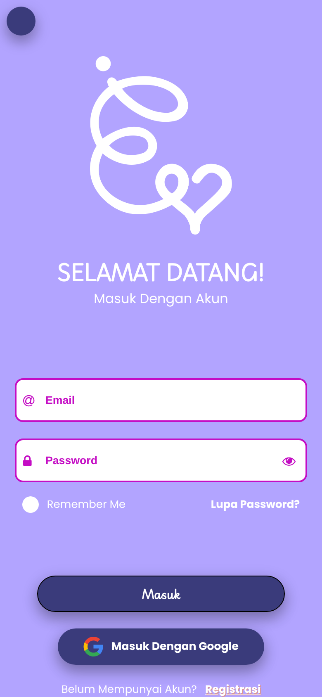
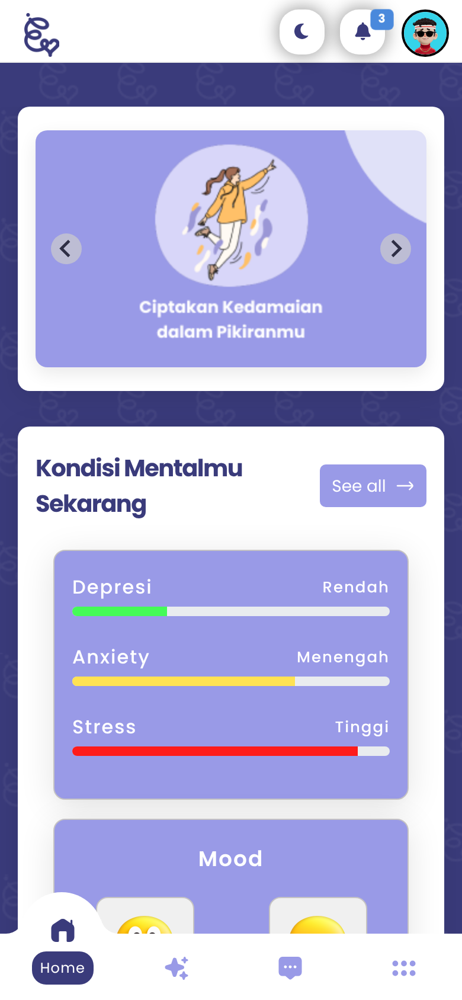
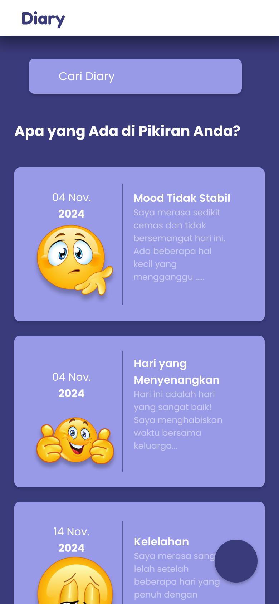
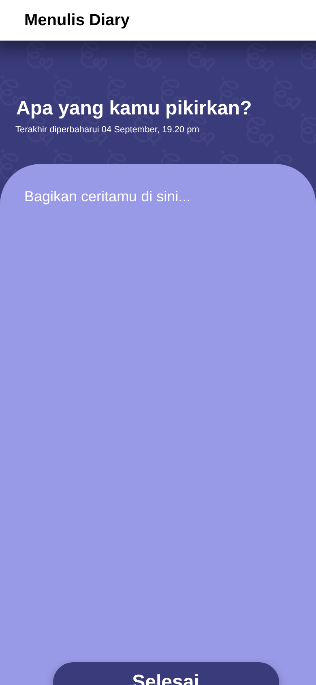
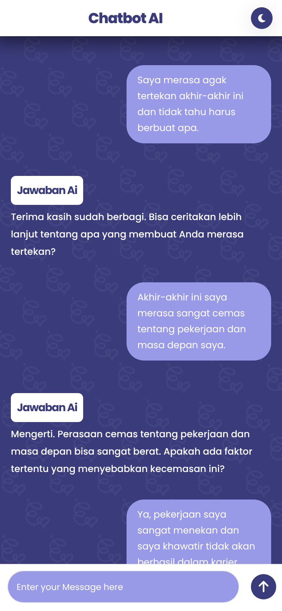
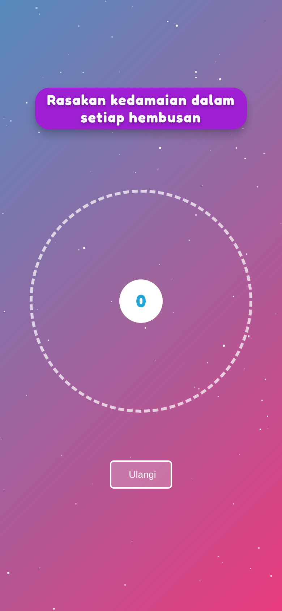
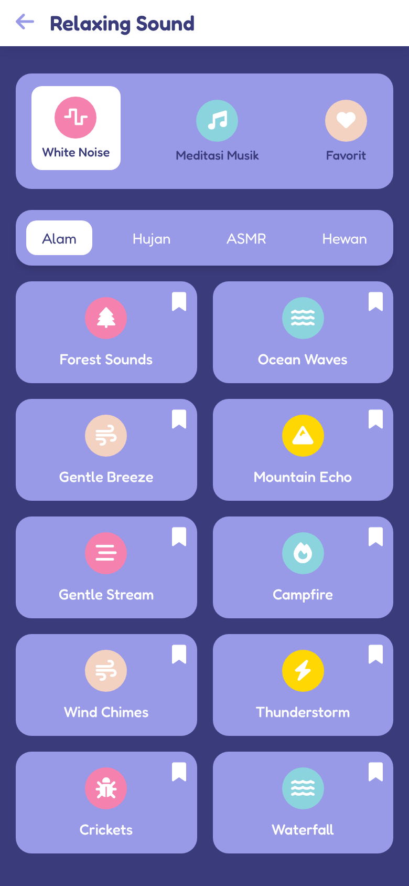
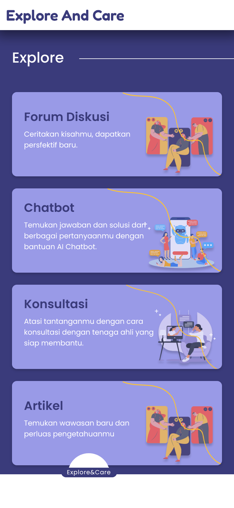
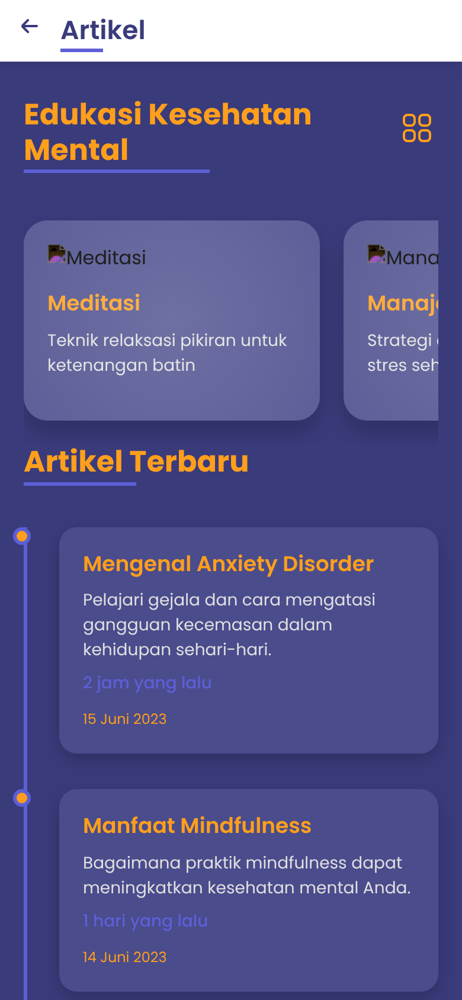

# Eunoia PWA — Screenshot Portfolio

Tangkapan layar asli dari front end PWA di repo ini (disajikan dengan `python3 -m http.server`), 390×844 @2×, headless Chromium via Playwright.

> Repo ini hanya berisi front end (HTML/CSS/JS) dengan konten contoh bawaan. Backend Laravel + LSTM tidak ada di sini, jadi analisis mood dan balasan AI yang tampil adalah konten statis, bukan keluaran model langsung. Halaman forum/diskusi sengaja tidak disertakan (contoh postingan sensitif).

| Login | Home | Diary List |
|:---:|:---:|:---:|
|  |  |  |
| Masuk akun | Banner, bar kondisi mental (depresi/anxiety/stress), mood | Daftar diary dengan mood |

| Tulis Diary | Chatbot AI | Breathing |
|:---:|:---:|:---:|
|  |  |  |
| Menulis catatan diary | Percakapan dengan chatbot | Latihan pernapasan |

| Relaxing Sound | Explore & Care | Artikel |
|:---:|:---:|:---:|
|  |  |  |
| Suara relaksasi | Menu Explore & Care | Artikel kesehatan mental |
